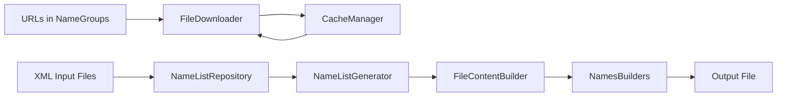
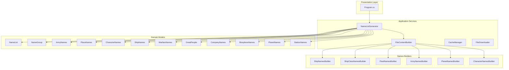
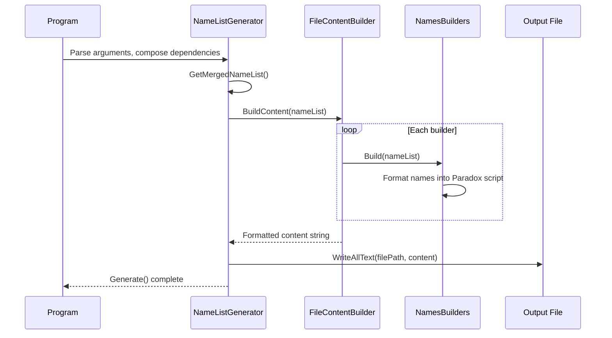
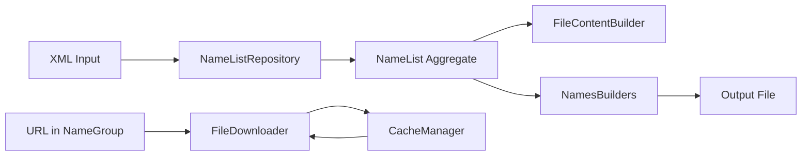
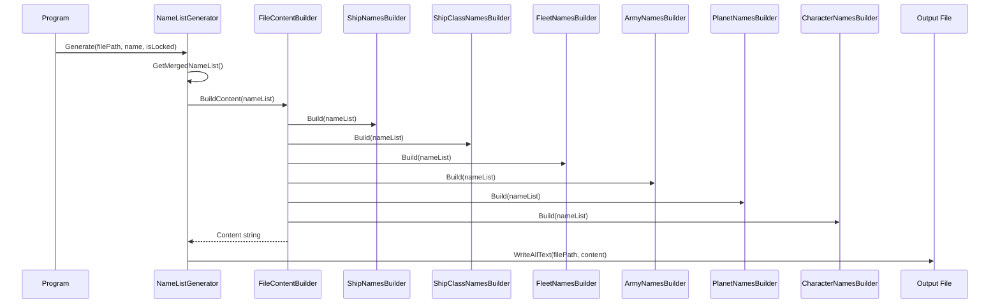
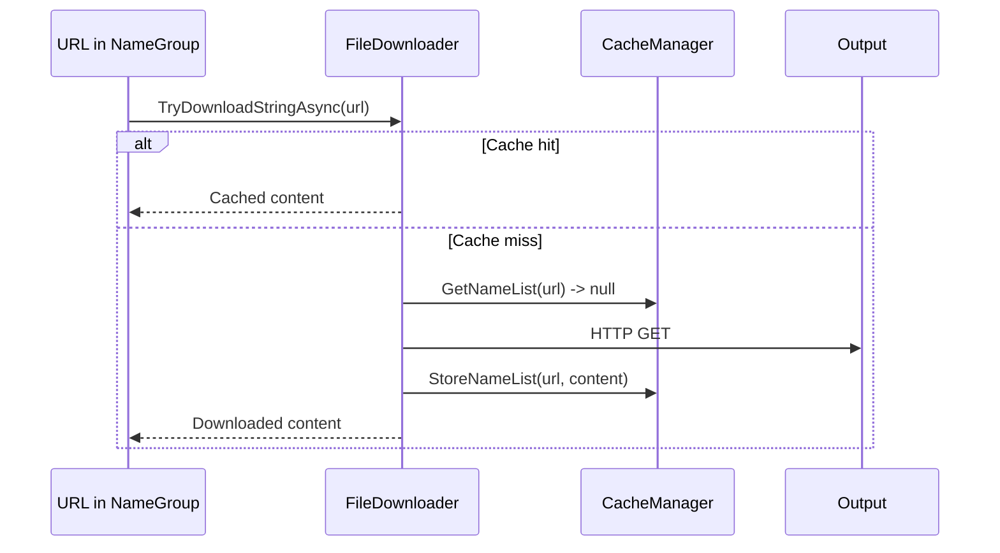
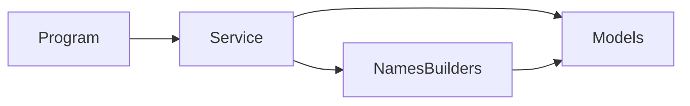

# Architecture

## 📑 Table of Contents

- [Purpose](#purpose)
- [System Context](#system-context)
- [Architectural Style](#architectural-style)
- [Runtime Flow](#runtime-flow)
- [Components](#components)
- [Architectural Areas](#architectural-areas)
- [Data Architecture](#data-architecture)
- [Interfaces and Integrations](#interfaces-and-integrations)
- [Key Processes](#key-processes)
- [Domain-Specific Concerns](#domain-specific-concerns)
- [Cross-Cutting Concerns](#cross-cutting-concerns)
- [Dependency Direction and Rules](#dependency-direction-and-rules)
- [External Dependencies](#external-dependencies)
- [Deployment and Operations](#deployment-and-operations)
- [Compatibility Contracts](#compatibility-contracts)
- [Testing and Verification](#testing-and-verification)
- [Design Constraints](#design-constraints)
- [Extension Points](#extension-points)
- [Evolution and Migration](#evolution-and-migration)
- [Architecture Decisions](#architecture-decisions)
- [Source Map](#source-map)
- [Related Documentation](#related-documentation)

## 🎯 Purpose

This document describes the current architecture of the Stellaris Name List Generator. The system is a .NET console application that generates Stellaris name list files from XML input sources. It reads one or more XML name list definitions, merges them, and produces a single Stellaris-compatible name list file in the game's Paradox script format.

The architecture is documented for maintainers who need to understand ownership boundaries, runtime flows, data transformations, and extension points when making changes.

## 🌐 System Context

The system is a standalone console application with no external network dependencies during normal operation. It reads XML files from disk, downloads name lists from URLs (with caching), and writes output files to disk.



The principal external boundaries are:
- **File Input**: XML name list definitions read from disk via `NuciDAL` repository abstraction
- **URL Download**: Name lists fetched from URLs with local caching (8-hour TTL)
- **File Output**: Generated name list written to disk as UTF-8 text

## 🏗️ Architectural Style

The system follows a layered architecture pattern:

1. **Presentation Layer** (`Program.cs`): CLI entry point, argument parsing, dependency composition
2. **Application Services** (`Service/`): Core generation logic — merging, building, writing
3. **Domain Models** (`Models/`): Plain C# entities representing name categories
4. **Names Builders** (`Service/NamesBuilders/`): Category-specific output formatters

The composition root (`Program.cs`) wires all dependencies together. Each builder implements `INamesBuilder`, allowing new categories to be added without modifying existing code.



## 🔄 Runtime Flow



The principal runtime sequence is:
1. `Program.Main()` parses CLI arguments and composes all dependencies
2. `NameListGenerator.Generate()` merges all input name lists and calls `FileContentBuilder.BuildContent()`
3. `FileContentBuilder` orchestrates each `INamesBuilder` to produce formatted output
4. The formatted content is written to the specified output file path

## 🧩 Components

| Component | Responsibility | Principal Dependencies | Lifetime or Ownership |
|-----------|----------------|----------------------|---------------------|
| `Program` | Entry point, CLI argument parsing, dependency composition | All services and builders | Process lifetime |
| `NameListGenerator` | Merges name lists, writes output file | `IFileContentBuilder`, `IFileRepository<NameList>` | Per-invocation |
| `FileContentBuilder` | Orchestrates all names builders, formats header | All six `INamesBuilder` implementations | Per-invocation |
| `CacheManager` | File-based URL cache with 8-hour TTL | None (filesystem only) | Process lifetime |
| `FileDownloader` | HTTP download with cache integration | `ICacheManager` | Static (shared across invocations) |
| `ShipNamesBuilder` | Generates ship name arrays from related categories | `NamesBuilder` base class | Per-invocation |
| `ShipClassNamesBuilder` | Generates ship class name arrays | `NamesBuilder` base class | Per-invocation |
| `FleetNamesBuilder` | Generates fleet name arrays with format templates | `NamesBuilder` base class | Per-invocation |
| `ArmyNamesBuilder` | Generates army name arrays including special armies | `NamesBuilder` base class | Per-invocation |
| `PlanetNamesBuilder` | Generates planet name arrays by class | `NamesBuilder` base class | Per-invocation |
| `CharacterNamesBuilder` | Generates character name arrays grouped by ID | `NamesBuilder` base class | Per-invocation |

## 🗂️ Architectural Areas

### Domain Models (`Models/`)

Paths:
- `StellarisNameListGenerator/Models/NameList.cs`
- `StellarisNameListGenerator/Models/NameGroup.cs`
- `StellarisNameListGenerator/Models/ArmyNames.cs`
- `StellarisNameListGenerator/Models/BiosphereNames.cs`
- `StellarisNameListGenerator/Models/CharacterNames.cs`
- `StellarisNameListGenerator/Models/CompanyNames.cs`
- `StellarisNameListGenerator/Models/GreatPeople.cs`
- `StellarisNameListGenerator/Models/MilitaryStationNames.cs`
- `StellarisNameListGenerator/Models/PlaceNames.cs`
- `StellarisNameListGenerator/Models/PlanetNames.cs`
- `StellarisNameListGenerator/Models/ShipNames.cs`
- `StellarisNameListGenerator/Models/StationNames.cs`
- `StellarisNameListGenerator/Models/WarfareNames.cs`
- `StellarisNameListGenerator/Models/WeaponNames.cs`

Responsibilities:
- Define domain entities for every Stellaris name category
- Provide parameterless constructors for XML deserialization
- Implement `IEnumerable` concatenation properties for grouped access
- Implement `AddRange()` on `NameList` for merging multiple inputs

Boundary rules:
- No dependencies on other layers; pure data structures
- Must remain XML-serializable (parameterless constructors required)

### Application Services (`Service/`)

Paths:
- `StellarisNameListGenerator/Service/NameListGenerator.cs`
- `StellarisNameListGenerator/Service/FileContentBuilder.cs`
- `StellarisNameListGenerator/Service/CacheManager.cs`
- `StellarisNameListGenerator/Service/FileDownloader.cs`
- `StellarisNameListGenerator/Service/ICacheManager.cs`
- `StellarisNameListGenerator/Service/IFileDownloader.cs`
- `StellarisNameListGenerator/Service/IFileContentBuilder.cs`
- `StellarisNameListGenerator/Service/INameListGenerator.cs`
- `StellarisNameListGenerator/Service/NamesBuilders/`

Responsibilities:
- `NameListGenerator`: Merge input lists, write output file
- `FileContentBuilder`: Orchestrate all builders, format header metadata
- `CacheManager`: File-based URL cache with 8-hour TTL
- `FileDownloader`: HTTP download with cache integration
- `NamesBuilders`: Category-specific output formatting

Boundary rules:
- Depend on domain models only
- Interfaces protect stable boundaries; concrete classes are sealed
- `FileDownloader` uses a static `HttpClient` for connection reuse

### Presentation Layer (`Program.cs`)

Path: `StellarisNameListGenerator/Program.cs`

Responsibilities:
- Parse CLI arguments via NuciCLI
- Compose all dependencies (builders, repository, generator)
- Invoke `NameListGenerator.Generate()`

Boundary rules:
- Depends on all services and builders
- No business logic; purely composition root

## 💾 Data Architecture

The system owns, transforms, and persists name list data. Data flows from XML input through domain models to formatted output.



| Data or Store | Owner | Representation and Storage | Lifecycle or Consistency |
|---------------|-------|---------------------------|--------------------------|
| `NameList` aggregate | `NameListGenerator` | In-memory object graph, XML-serializable | Merged from repository at generation time |
| `NameGroup` | `NameGroup` model | Explicit values + URL-derived values | Downloaded lazily on first access |
| URL cache | `CacheManager` | Filesystem under `.cache/` directory | 8-hour TTL; file creation time checked |
| Output file | `NameListGenerator` | UTF-8 text file on disk | Written once per generation invocation |

## 🔌 Interfaces and Integrations

| Interface or Integration | Direction | Contract | Owner | Failure Semantics |
|-------------------------|-----------|----------|-------|-------------------|
| `INameListGenerator.Generate` | Outbound | `void Generate(string filePath, string name, bool isLocked)` | `NameListGenerator` | Writes file; no failure translation |
| `IFileContentBuilder.BuildContent` | Outbound | `string BuildContent(NameList nameList)` | `FileContentBuilder` | Returns formatted string; no failure translation |
| `IFileRepository<NameList>.GetAll` | Inbound | `List<NameList> GetAll()` | `NuciDAL` | Repository abstraction; XML deserialization errors propagate |
| `IFileDownloader.TryDownloadStringAsync` | Outbound | `Task<string> TryDownloadStringAsync(string url)` | `FileDownloader` | Cache hit returns cached content; miss returns downloaded content |
| `ICacheManager.StoreNameList` / `GetNameList` | Bidirectional | `void StoreNameList(string url, string content)` / `string GetNameList(string url)` | `CacheManager` | 8-hour expiry returns null; writes persist to filesystem |

## 🔀 Key Processes

### Name List Generation



Ordering: `ship_names` → `ship_class_names` → `fleet_names` → `army_names` → `planet_names` → `character_names`. Each builder formats its category independently. The header section (ID, name, leaders, ships, fleets, colonies) is generated first, then the body sections follow in fixed order.

Ownership: `FileContentBuilder` owns the ordering contract. Adding or reordering builders requires updating this orchestration.

Invariants:
- Header always precedes body sections
- Each body section is independently formatted
- `randomized = yes` or `no` is set based on `isLocked` flag

### Name Download



Ownership: `FileDownloader` handles HTTP and caching. `CacheManager` owns the filesystem cache.

## ⚙️ Domain-Specific Concerns

### Unicode Normalization

The `NamesBuilder.ProcessName()` method performs extensive character mapping to ensure game compatibility. This includes:

- Accent mapping (e.g., `Ά` → `Á`, `Ά` → `À`, `Ά` → `Ă`)
- Ligature mapping (e.g., `Χ` → `Ch`, `Č` → `Ch`)
- Diacritic normalization (floating accents, tildas, commas, hooks)
- Character set replacements (e.g., `Ǣ` → `Æ`, `Ǟ` → `Ä`)
- Apostrophe detachment (e.g., `ƙ` → `k'`)

This is a domain-specific concern because it directly affects game compatibility. The mapping table is extensive (~500+ entries) and must be maintained carefully.

### Generic Name Cleaning

`CleanGenericNames()` removes generic names that appear in specific categories, preventing duplicate names in the output. This is domain-specific because it depends on the semantic relationship between categories (e.g., "generic" ship names should not duplicate deity names).

## 🧵 Cross-Cutting Concerns

### Concurrency and Resource Use

- `FileDownloader` uses a static `HttpClient` for connection reuse
- `CacheManager` uses `ConcurrentBag` for thread-safe collection operations
- `CleanGenericNames` uses `Parallel.ForEach` for concurrent processing
- No shared mutable state between components

### Error Handling

- `NameListGenerator.Generate()` propagates exceptions from `FileContentBuilder.BuildContent()` and `File.WriteAllText()`
- `FileDownloader` has no failure translation — download failures propagate to caller
- `CacheManager` silently returns null on expired cache entries

## 🧭 Dependency Direction and Rules



The principal dependency rules are:
- `Program` depends on all services and builders (composition root)
- `Service` depends on `Models` only
- `NamesBuilders` depend on `Models` only
- No circular dependencies exist
- Interfaces (`I*`) protect stable boundaries

## 📦 External Dependencies

| Dependency | Responsibility | Integration Boundary | Architectural Consequence |
|------------|----------------|----------------------|--------------------------|
| `NuciCLI` | Command-line argument parsing | `Program.Main()` | Standardizes CLI interface |
| `NuciCLI.Arguments` | Argument parsing utilities | `Program.Main()` | Reduces boilerplate |
| `NuciDAL` | XML repository access | `NameListGenerator` | Abstracts file I/O |
| `NuciExtensions` | Collection and text utilities | `NamesBuilder`, `PlanetNamesBuilder` | Provides `EnumerableExt`, `DoNamesMatch` |

## 🚀 Deployment and Operations

| Concern | Current Design | Architectural Consequence |
|---------|---------------|--------------------------|
| Process topology | Single .NET console app | No multi-process scaling needed |
| Persistent state | Output file on disk | Simple file-based persistence |
| Scaling assumptions | Single invocation per run | No concurrency requirements |
| Startup | Immediate after argument parsing | No initialization delays |
| Operator-visible outputs | Generated file path | User specifies output location |

## 🛡️ Compatibility Contracts

| Contract | Owner | Invariant | Verification | Change Policy |
|----------|-------|-----------|-------------|--------------|
| `INamesBuilder.Build` | Each builder | Produces valid Paradox script array syntax | Unit tests per builder | Breaking change requires new builder |
| `NameList.AddRange` | `NameList` | Merges collections without duplication | `NameListTests.AddRange` | Breaking change requires update |
| `NameGroup.Values` | `NameGroup` | Combines explicit + URL values | `NameGroupTests` | Breaking change requires update |
| Output file format | `FileContentBuilder` | Correct Paradox script with proper indentation | Example output validation | Breaking change requires update |

## ✅ Testing and Verification

Execute the principal automated verification with:

```bash
dotnet test StellarisNameListGenerator.UnitTests/StellarisNameListGenerator.UnitTests.csproj --verbosity normal
```

Test boundaries:
- `NameListGeneratorTests`: Tests merging logic, file writing, ID assignment
- `FileContentBuilderTests`: Tests content building, header formatting, merge behavior
- `NameListTests`: Tests defaults, AddRange, property storage
- `NameGroupTests`: Tests IsEmpty, Values, URL behavior
- `CharacterNamesTests`: Tests IsEmpty, gender-specific groups
- `PlaceNamesTests`: Tests WaterBodies, GeographicalPlaces concatenation
- `OtherModelTests`: Tests all model default initializations

Material coverage gaps:
- No integration tests for end-to-end generation
- No UI or manual verification procedures documented
- Builder-specific formatting edge cases not exhaustively tested

## ⚠️ Design Constraints

- **Parameterless constructors required**: All models must have parameterless constructors for XML deserialization
- **Sealed service classes**: Concrete service classes are sealed to prevent substitution
- **Static HttpClient**: `FileDownloader` uses a static client for connection pooling
- **No async in main flow**: `Generate()` is synchronous; async download is handled internally
- **Fixed builder order**: `FileContentBuilder` hardcodes the order of builder invocations

## 🔧 Extension Points

### Adding a New Name Category

1. Create a new model class in `Models/` with parameterless constructor
2. Create an `INamesBuilder` implementation in `Service/NamesBuilders/`
3. Register the builder in `FileContentBuilder.BuildContent()`
4. Add unit tests in `StellarisNameListGenerator.UnitTests/`

### Adding a New URL Source

1. `NameGroup` already supports `Url` property
2. `FileDownloader` already handles HTTP download
3. No additional infrastructure needed

## 🌱 Evolution and Migration

### Current State

The system is a single-project console application with clean separation between models, services, and builders.

### Target State

No target architecture is defined. The current design is considered stable.

### Transition

No migration phases are planned.

## 📝 Architecture Decisions

| Decision | Rationale | Consequence | Record |
|----------|-----------|-------------|--------|
| Layered architecture (Presentation/Application/Domain) | Clear separation of concerns | Easy to understand and modify | Documented in ARCHITECTURE.md |
| Builder pattern for name formatting | Each category has distinct formatting needs | New categories can be added without modifying existing code | Documented in ARCHITECTURE.md |
| `NamesBuilder` abstract base class | Shared formatting logic (arrays, dedup, Unicode) | Reduces duplication across builders | Documented in ARCHITECTURE.md |
| File-based URL cache | Simple, no database dependency | 8-hour TTL; file creation time checked | Documented in ARCHITECTURE.md |
| Static HttpClient in FileDownloader | Connection pooling, reduced overhead | Shared across all invocations | Documented in ARCHITECTURE.md |

## 🗺️ Source Map

| Area | Path |
|------|------|
| Presentation Layer | `StellarisNameListGenerator/Program.cs` |
| Application Services | `StellarisNameListGenerator/Service/` |
| Domain Models | `StellarisNameListGenerator/Models/` |
| Names Builders | `StellarisNameListGenerator/Service/NamesBuilders/` |
| Test Project | `StellarisNameListGenerator.UnitTests/` |

## 📚 Related Documentation

- [Repository Overview](repository-overview.md) — Project purpose and scope
- [Repository Structure](repository-structure.md) — Directory layout
- [Data Model](data-model.md) — Domain entities and relationships
- [Components](components/presentation.md) — CLI and service details
- [Flows](flows/name-list-generation.md) — End-to-end generation pipeline
- [Configuration](configuration.md) — CLI arguments and options
- [Dependencies](dependencies.md) — External libraries
- [Build and Deployment](build-and-deployment.md) — Build, publish, release
- [Testing](testing.md) — Test structure and execution
- [Change Guide](change-guide.md) — How to make common changes safely
- [Design Decisions](design-decisions.md) — Key architectural decisions
- [Ambiguities](ambiguities.md) — Known uncertainties
